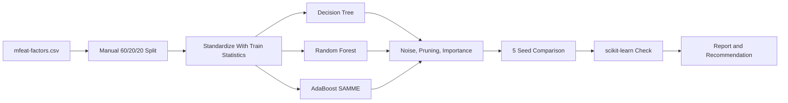
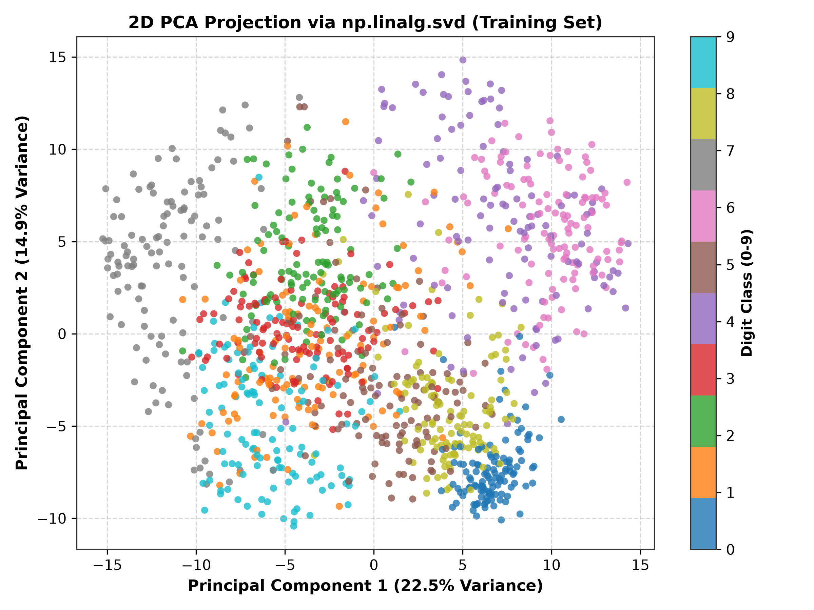
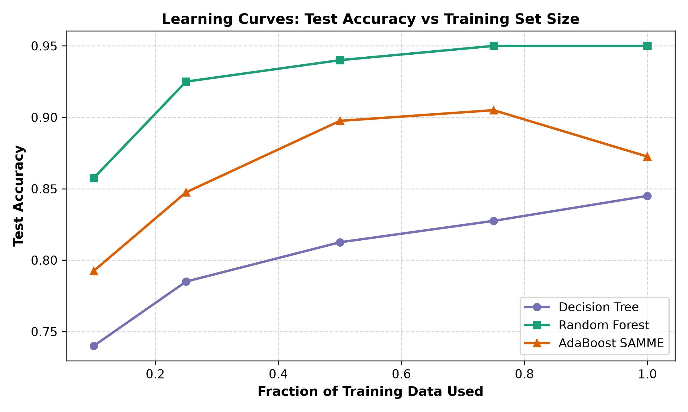
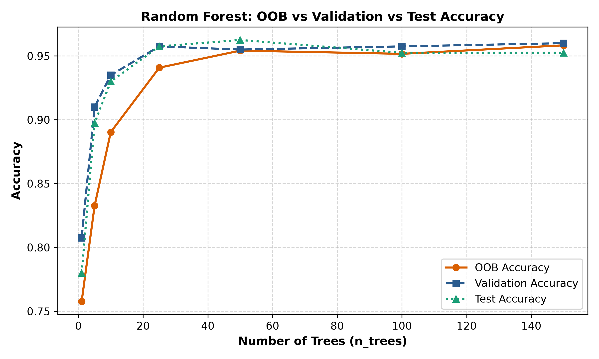
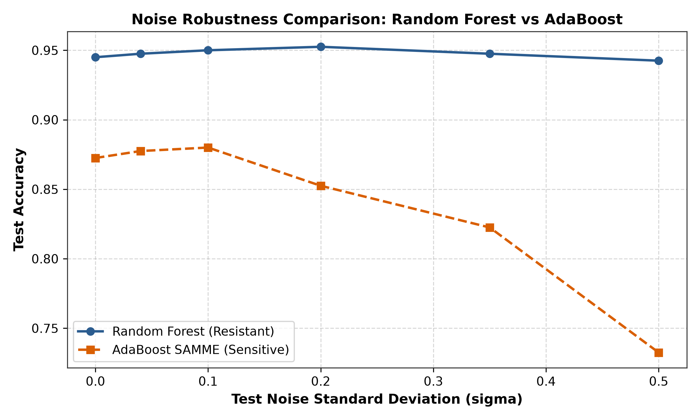
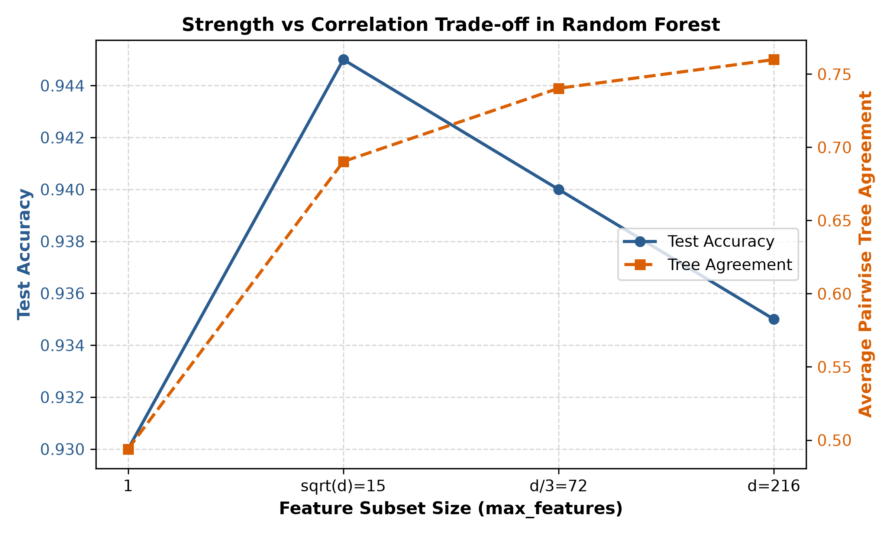
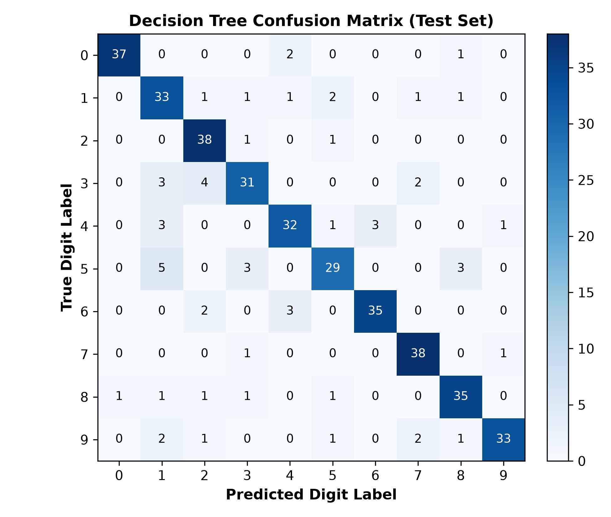

<div align="center">

<!-- Animated header banner -->


<br/>


<br/>

[Notebook](./24i-2013_abdul_BAI-5A.ipynb) &nbsp;|&nbsp; [Report PDF](./24i-2013_abdul_BAI-5A_report.pdf) &nbsp;|&nbsp; [Repository](https://github.com/AbdulAzeemHashmi/tree-ensemble-benchmark)

</div>

---

## Table of Contents

- [Overview](#overview)
- [Results at a Glance](#results-at-a-glance)
- [Pipeline](#pipeline)
- [Dataset](#dataset)
- [Fixed Settings](#fixed-settings)
- [What Is Inside Each Model](#what-is-inside-each-model)
- [Main Results](#main-results)
- [Key Findings](#key-findings)
- [Charts](#charts)
- [Worked Example](#worked-example)
- [Limitations](#limitations)
- [Repository Structure](#repository-structure)
- [Technology](#technology)
- [Run the Notebook](#run-the-notebook)

---

## Overview

This repository compares three tree based classifiers on handwritten digit data: a **decision tree**, a **random forest**, and **AdaBoost with SAMME**. All three are written from scratch with NumPy. The model code lives inside the notebook, together with the experiments, plots, results, and written explanations.

The goal is to see how each model handles overfitting, variance, noise, and feature importance, and to back every claim with a number from the experiments.

<div align="center">

</div>

---

## Results at a Glance

| Model | Test Accuracy | Macro F1 |
|---|---:|---:|
| Decision Tree (depth 9) | 83.90% ± 2.71% | 0.8396 |
| Pruned Decision Tree | 84.35% ± 2.15% | 0.8447 |
| **Random Forest (30 trees)** | **95.15% ± 0.96%** | **0.9514** |
| AdaBoost SAMME (35 rounds) | 87.35% ± 1.55% | 0.8741 |

Mean and standard deviation over 5 seeds (2013 to 2017), each with its own stratified split. Random Forest is the best model and won on all 5 seeds.

---

## Pipeline

<div align="center">



</div>

---

## Dataset

| Item | Value |
|---|---|
| File | `mfeat-factors.csv` |
| Samples | 2,000 handwritten digits (200 per digit) |
| Features | 216 numeric factor analysis attributes (not raw pixels) |
| Target | Digit label from 0 to 9 |
| Train split | 1,200 samples (120 per digit) |
| Validation split | 400 samples (40 per digit) |
| Test split | 400 samples (40 per digit) |

The split is done by hand with NumPy. Features are standardized with training set statistics only, so no test information leaks into training. A PCA view computed with `np.linalg.svd` shows that digits 0 and 1 form clear groups, while digits 3, 5, and 8 overlap heavily.

---

## Fixed Settings

These values are printed in the first cell of the notebook and used everywhere.

| Setting | Value | What it controls |
|---|---:|---|
| alpha | 1.3 | Power in the custom entropy formula |
| base b | 3 | Logarithm base in the entropy formula |
| lambda | 0.06 | Weight of the feature correlation penalty on information gain |
| q | 0.13 | Percentile used for quantile based split thresholds |
| stop_eps | 0.15 | Minimum information gain to keep splitting |
| sigma | 0.04 | Standard deviation of the added Gaussian noise |
| seed | 2013 | Base seed for every random generator |

---

## What Is Inside Each Model

<details open>
<summary><b>Decision Tree</b></summary>
<br/>

- **Custom entropy:** `H(p) = - sum( p_i^alpha * log_b(p_i + epsilon) )`, with alpha 1.3 and base 3
- **Penalized information gain:** `IG_pen = IG - lambda * rho(f)`, where rho is the mean absolute Pearson correlation between a feature and the 10 one hot digit indicators
- **Two split strategies:** a quantile split and a vectorized exhaustive split that sorts each feature once and uses cumulative class counts
- **Stopping rules:** gain below stop_eps, depth limit, too few samples, or a pure node
- **Extras:** noise injection, reduced error pruning on the validation set, impurity based feature importance, and decision paths for single predictions

</details>

<details open>
<summary><b>Random Forest</b></summary>
<br/>

- Bootstrap samples drawn with replacement
- A random subset of sqrt(216) = 15 features at every split
- Two voting methods: majority voting and probability averaging
- Out of bag (OOB) accuracy as a free validation estimate
- Permutation importance on the validation set

</details>

<details open>
<summary><b>AdaBoost (SAMME)</b></summary>
<br/>

- Weighted decision tree learners of depth 1 to 3
- Multiclass SAMME update with `alpha_m = ln((1 - error) / error) + ln(K - 1)` and K = 10
- Sample weights grow on hard examples so later trees focus on them
- A validation based early stopping rule with patience 8

</details>

---

## Main Results

All metrics are computed by hand in the notebook, with no library metric functions.

### Per Digit F1 Scores (5 seed mean)

| Model | 0 | 1 | 2 | 3 | 4 | 5 | 6 | 7 | 8 | 9 |
|---|---:|---:|---:|---:|---:|---:|---:|---:|---:|---:|
| Decision Tree | 0.939 | 0.783 | 0.848 | 0.733 | 0.927 | 0.759 | 0.896 | 0.848 | 0.857 | 0.806 |
| Pruned Tree | 0.935 | 0.800 | 0.845 | 0.757 | 0.931 | 0.781 | 0.897 | 0.860 | 0.824 | 0.817 |
| **Random Forest** | 0.985 | 0.946 | 0.957 | 0.911 | 0.972 | 0.927 | 0.963 | 0.960 | 0.954 | 0.939 |
| AdaBoost | 0.840 | 0.896 | 0.929 | 0.831 | 0.915 | 0.820 | 0.923 | 0.897 | 0.828 | 0.863 |

### Paired Comparison, Random Forest vs AdaBoost

- Random Forest won on **5 of 5 seeds**
- Per seed accuracy gaps: 0.085, 0.100, 0.035, 0.090, 0.080
- Mean gap: **+7.80% ± 2.25%**, which is clearly larger than the seed to seed spread

### Check Against scikit-learn

scikit-learn is used only here, as a labeled check on one split.

| Model | From Scratch | scikit-learn | Gap |
|---|---:|---:|---:|
| Decision Tree (depth 9) | 84.25% | 82.50% | +1.75% |
| Random Forest (30 trees) | 95.75% | 95.50% | +0.25% |
| AdaBoost (SAMME) | 87.25% | 86.75% | +0.50% |

Every gap is below 3 percentage points, so the from scratch code behaves like the reference library.

---

## Key Findings

1. **The penalty can change the root split.** With no penalty, feature att94 wins the root (gain 0.10870). With lambda 0.06, att97 wins (0.09437 against 0.09271), because it is less correlated with the classes.
2. **Alpha must stay moderate.** At alpha 1.3 the uniform distribution still gives the highest entropy. At alpha 2.0 it no longer does (uniform 0.2096, skewed 0.2260), so the measure stops behaving like a true entropy.
3. **Exhaustive splits beat quantile splits.** A fixed 13th percentile cut reached 62.50% test accuracy, while the exhaustive search reached 80.25%.
4. **Pruning shrinks the overfit gap.** Reduced error pruning cut the tree from 82 to 41 leaves. The train to test gap fell from 15.75 to 9.67 points, and test accuracy rose from 84.25% to 85.25%.
5. **Small noise barely hurts a single tree.** At sigma 0.04 the tree scored 84.50% (clean train, clean test), 84.25% (clean, noisy), 83.00% (noisy, clean), and 82.25% (noisy, noisy).
6. **Forests cut variance.** Over 20 runs, single trees scored 81.99% ± 1.75% and 15 tree forests scored 93.41% ± 0.77%, a variance drop of about 5.2 times.
7. **Feature subsets matter.** As max_features grew from 1 to all 216, agreement between trees rose from 0.52 to 0.88. The default of 15 features gave the best balance.
8. **Probability averaging is slightly better.** 96.50% against 96.25% for majority voting on one split.
9. **Impurity and permutation importance can disagree.** The largest gap was att6, with permutation importance of -0.0063 and impurity importance of 0.0245.
10. **Boosting is more sensitive to noise.** At sigma 0.35, Random Forest kept 94.8% accuracy while AdaBoost fell to 82.2%, since boosting keeps raising the weights on points it gets wrong.
11. **Depth matters for boosting.** Depth 1 stumps leveled off near 28% test error, while depth 3 learners reached 87.25% accuracy within 35 rounds.
12. **Early stopping saved time but cost accuracy.** With patience 8, AdaBoost stopped at round 61 and scored 90.25%, against 92.50% for all 100 rounds. That is 39% fewer rounds for a 2.25 point drop.
13. **Confusions follow the PCA view.** Digits 3, 5, and 8 are mixed up most, and digits 1 and 2 are also confused. Digits 0 (38 of 40 correct) and 4 (36 of 40 correct) are easy.

**Recommendation:** deploy the Random Forest. It has the best accuracy, the lowest variance across seeds, and balanced F1 scores on all 10 digits. An early stopped AdaBoost with depth 2 learners is only a fallback for tiny devices with clean data.

---

## Charts

The notebook shows every chart inline, and the PNG files are saved in `figures/`.

<div align="center">

<table>
<tr>
<td align="center"><br/><sub>PCA projection computed with SVD</sub></td>
<td align="center"><br/><sub>Learning curves for the three models</sub></td>
</tr>
<tr>
<td align="center"><br/><sub>Out of bag, validation, and test accuracy</sub></td>
<td align="center"><br/><sub>Random Forest against AdaBoost under noise</sub></td>
</tr>
<tr>
<td align="center"><br/><sub>Feature subset size and tree agreement</sub></td>
<td align="center"><br/><sub>Decision tree confusion matrix</sub></td>
</tr>
</table>

</div>

---

## Worked Example

Test sample 0 has the true label digit 8. All three models get it right.

| Model | How it decided | Result |
|---|---|---|
| Decision Tree | Six splits from att97 down to att68, ending in a pure leaf | Digit 8 (probability 1.000) |
| Random Forest (30 trees) | 29 trees voted digit 8, 1 tree voted digit 6 | Digit 8 (probability 0.966) |
| AdaBoost (35 rounds) | Weighted score 25.473 for digit 8 against 10.636 for digit 3 | Digit 8 |

The notebook also prints decision paths for three correct and three wrong test samples, such as test index 4 (true 0, predicted 8) and test index 20 (true 8, predicted 3).

---

## Limitations

- The 216 features are pre computed factor values, not pixels, so the findings may not carry over to raw image data.
- Forests were tested up to 150 trees and AdaBoost up to 100 rounds, so more tuning could add small gains.
- The stop_eps value of 0.15 is larger than the best root gain (0.1087), so it cannot be applied strictly without depth controls.
- Results come from one dataset and 5 seeds.

---

## Repository Structure

```text
tree-ensemble-benchmark/
|-- 24i-2013_abdul_BAI-5A.ipynb
|-- 24i-2013_abdul_BAI-5A_report.pdf
|-- mfeat-factors.csv
|-- figures/
|   |-- eda_class_balance.png
|   |-- eda_correlation_heatmap.png
|   |-- eda_pca_projection.png
|   |-- a1_entropy_curves.png
|   |-- a3_feature_thresholds.png
|   |-- a5_noise_drift_curves.png
|   |-- a6_pruning_curve.png
|   |-- a7_confusion_matrix.png
|   |-- a7_feature_importance.png
|   |-- b2_oob_curve.png
|   |-- b3_max_features_tradeoff.png
|   |-- b4_permutation_vs_impurity.png
|   |-- c2_adaboost_error_rounds.png
|   |-- c2_sample_weight_distribution.png
|   |-- c3_noise_rf_vs_adaboost.png
|   |-- d_learning_curves.png
|   `-- d_training_time_vs_accuracy.png
`-- README.md
```

| File | Description |
|---|---|
| `24i-2013_abdul_BAI-5A.ipynb` | The executed notebook with the scratch implementations, data preparation, model comparisons, checks, plots, and the written report. Outputs and plots are saved in the notebook |
| `24i-2013_abdul_BAI-5A_report.pdf` | A four page report with the main results, figures, analysis, limitations, recommendation, and an example prediction |
| `mfeat-factors.csv` | The data file: 2,000 digit samples, 216 numeric features, and a label from 0 to 9 |
| `figures/` | PNG charts for data exploration, model behavior, evaluation, and comparisons |
| `README.md` | This file |

---

## Technology

| Tool | Used for |
|---|---|
| Python 3 | The language for everything |
| NumPy | Model code and all calculations |
| pandas | Reading the CSV data |
| Matplotlib | Charts |
| scikit-learn | The labeled verification comparison only |
| Jupyter Notebook | Running and viewing the work |

---

## Run the Notebook

Clone the repository and move into its folder:

```bash
git clone https://github.com/AbdulAzeemHashmi/tree-ensemble-benchmark.git
cd tree-ensemble-benchmark
```

Install the Python packages:

```bash
python -m pip install numpy pandas matplotlib scikit-learn notebook
```

Start Jupyter:

```bash
jupyter notebook
```

Open `24i-2013_abdul_BAI-5A.ipynb` and run the cells from top to bottom. Keep `mfeat-factors.csv` and the `figures` folder beside the notebook. The experiment cell can take several minutes because it trains many models and repeats the comparison across 5 seeds. It also writes `experiment_results.json` and refreshes the images in `figures/`.

---

<div align="center">


</div>